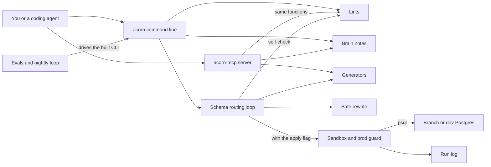

# How Acorn works

Acorn is a database helper for developers and coding agents who build multi-tenant apps on Postgres, Supabase or Neon.
A multi-tenant app keeps many customers, called tenants, in one database.
Acorn designs tables and writes migrations, which are SQL files that change the schema.
It rewrites risky migrations so they do not lock busy tables for long.
It also writes row-level security (RLS) policies, the Postgres rules that decide which rows each user may see.
It lints SQL you already have, and it plans pgvector tables and connection strings.
Every check is plain code that reads SQL text, so the core needs no model and no key.

## The parts



You reach Acorn in two ways.
The command line starts in [src/index.ts](../src/index.ts) and loads one command group per file from [src/commands/](../src/commands/).
The MCP server in [src/mcp/server.ts](../src/mcp/server.ts) answers JSON-RPC over standard input and output.
MCP, the Model Context Protocol, lets an agent call tools by name.
Its 12 tools in [src/mcp/tools.ts](../src/mcp/tools.ts) call the same functions as the command line.
Both can search the brain, a folder of Markdown notes in [brain/](../brain/), through [src/brain/search.ts](../src/brain/search.ts).

The generators in [src/gen/](../src/gen/) choose a tenancy model and write policies, vector plans and connection strings.
The lints in [src/lint/](../src/lint/) flag known pitfalls by rule id, such as P1 or P10.
[src/transform/safe-migration.ts](../src/transform/safe-migration.ts) rewrites risky schema changes into safer steps.
The sandbox code in [src/sandbox/](../src/sandbox/) refuses any database URL that looks like production before it runs SQL through `psql`.
Each apply attempt is logged to `logs/runs.jsonl` in the current folder.
The evals in [eval/](../eval/) and the loop in [workflows/rsi.workflow.js](../workflows/rsi.workflow.js) drive the built command line to catch regressions.

## What happens when you run it

The main flow turns a one-line brief into tables and policies:
`acorn schema "a helpdesk: orgs have members, members file tickets" --apply --verify-rls`.

1. [src/index.ts](../src/index.ts) parses the arguments with commander and hands them to [src/commands/schema.ts](../src/commands/schema.ts). An empty brief stops here with exit code 2.
2. The command calls `runSchemaFlow` in [src/dispatch/schema-flow.ts](../src/dispatch/schema-flow.ts). Without `--apply` and without `DATABASE_URL`, the run is a dry run.
3. Design: `decideTenancy` in [src/gen/tenancy.ts](../src/gen/tenancy.ts) picks shared tables with RLS by default. Words such as "regulated" or "bank" pick one database per tenant.
4. Migration: `deriveSchema` turns phrases such as "orgs have members" into `CREATE TABLE` statements. The first noun becomes the tenant root, and every later table points back to it.
5. Safe rewrite: `safeMigration` in [src/transform/safe-migration.ts](../src/transform/safe-migration.ts) adds a lock timeout and safer forms of risky statements.
6. Policies: `genRlsPolicy` in [src/gen/rls-policy.ts](../src/gen/rls-policy.ts) writes two policies and an index per table. A brief that says "clerk" gets a text cast on the user id.
7. Self-check: `lintRls` and `lintMigration` read the generated SQL. An error marks the step blocked, and a dry run then exits with code 1.
8. Each of the five steps prints a numbered line through [src/dispatch/log-step.ts](../src/dispatch/log-step.ts).
9. Apply: the command writes `migrations/0001_acorn_schema.sql`. `resolveSandbox` in [src/sandbox/branch-lifecycle.ts](../src/sandbox/branch-lifecycle.ts) picks the target database. With no ready database, the apply is deferred and the exit code is 2.
10. Guard: `prodGuard` in [src/sandbox/provision.ts](../src/sandbox/provision.ts) allows only local or branch databases, or one you mark as dev with `ACORN_DEV_DB=1`. Any URL with a production marker is refused.
11. Ledger: the SQL runs through `psql`, and a hash of it goes into a table named `__acorn_migrations`. A second run then prints "no migrations to apply".
12. Verify: the command counts rows as the `anon` role in `public.tickets`, or in the table given by `--rls-table`. It does this on a re-run too, and the result line names the table. Zero rows or "permission denied" pass. Any visible row fails the run with exit code 1, and a probe that cannot run exits with code 2.

## Extending it

- **A lint rule.** Add the check to [src/lint/rls.ts](../src/lint/rls.ts) or [src/lint/migration.ts](../src/lint/migration.ts). Push a `Violation`, typed in [src/lint/types.ts](../src/lint/types.ts), with a rule id. Add a SQL fixture to [test/fixtures/](../test/fixtures/) and a case to [test/lint/](../test/lint/).
- **A command.** Write a factory that returns a commander `Command` in [src/commands/](../src/commands/). Register it in `buildProgram` in [src/index.ts](../src/index.ts).
- **An MCP tool.** Add an entry to `TOOLS` in [src/mcp/tools.ts](../src/mcp/tools.ts) that calls an existing function. Then update [test/contract/mcp-jsonrpc.test.ts](../test/contract/mcp-jsonrpc.test.ts), which expects exactly 12 tools.
- **A skill.** Create `skills/<name>/SKILL.md` with `name` and `description` front matter, like [skills/harden-rls/SKILL.md](../skills/harden-rls/SKILL.md). List it under `skills` in [.claude-plugin/plugin.json](../.claude-plugin/plugin.json).
- **An eval.** Add a check to `HOUSE_RULES` in [eval/eval.py](../eval/eval.py). Or add a golden task to [eval/golden/tasks.json](../eval/golden/tasks.json) with a `kind` that `_structural_ok` already handles.

Run these before you push:

```bash
pnpm install
pnpm build
pnpm test
python3 eval/eval.py --l1-only
python3 eval/judge.py --selftest
```

## Questions

**Does it need an API key or cost money?**
No key is needed for the command line, the MCP server, the lints or the evals here.
Live features need a database that you provide through `DATABASE_URL`.
The `neon` provider can create a branch with `neonctl` when `NEON_API_KEY` is set, on your own Neon account.

**Does any data leave the machine?**
The code in [src/](../src/) makes no web requests.
It sends SQL only to the database in `DATABASE_URL`, through `psql`.
With the `neon` provider and a key, it also calls `neonctl`, which talks to Neon.
The MCP server uses standard input and output, and the cockpit in [cockpit/](../cockpit/) listens on 127.0.0.1 only.

**How does it improve itself?**
[dsip.json](../dsip.json) declares the `agent` level, with a nightly loop and no self-grading.
[.github/workflows/rsi.yml](../.github/workflows/rsi.yml) runs [workflows/rsi.workflow.js](../workflows/rsi.workflow.js) every day at 09:00 UTC.
The loop reruns the structural evals and flags brain notes older than the newest tool-version date it tracks.
It prints a proposed change and a verdict, and CI keeps them as an artifact.
Nothing is applied or merged by the loop. The model half of the loop is not built yet.

**How do I run its tests or evals?**
Run `pnpm build`, then `pnpm test` for the Vitest suites in [test/](../test/).
Run `python3 eval/eval.py --l1-only` for the 12 house-rule checks, which need no database.
Run `python3 eval/eval.py` for all 15 golden tasks. Tasks that need a database skip with a stated reason when `DATABASE_URL` is unset.
Run `python3 eval/judge.py --selftest` to check its scorer against 16 hand-labelled migration examples.

**What does it not do?**
It writes no app code, query call sites or API routes.
It does not set up auth providers or generate embeddings.
It never writes to a database that looks like production.
Its Claude Code hook, [hooks/block-prod-push.sh](../hooks/block-prod-push.sh), also blocks `drizzle-kit push` against a database it cannot prove is local, dev or a branch.
Four commands only print guidance today: `rls test`, `vector recall`, `migration ledger-backfill` and `backup plan`.
